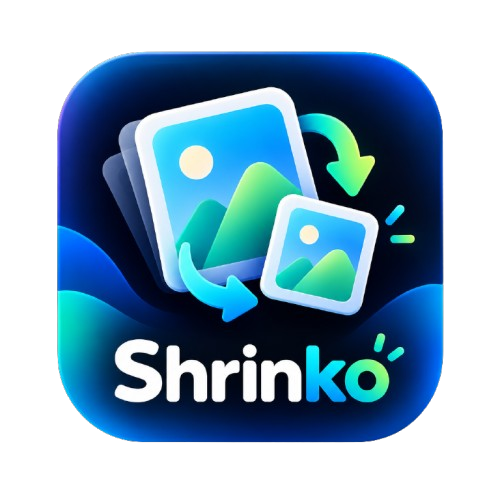
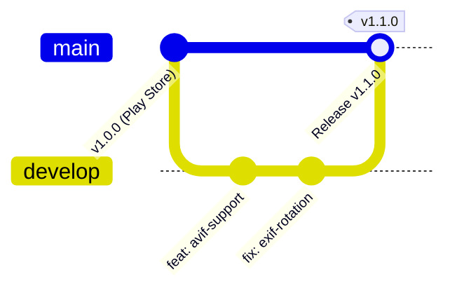

<p align="center">
  
</p>

<h1 align="center">Shrinko - Image Compressor & Optimizer</h1>

<p align="center">
  <strong>Fast, offline-first Android image compression and resizing utility built with Kotlin and Jetpack Compose.</strong>
</p>

<p align="center">
  <a href="https://play.google.com/store/apps/details?id=com.cheatpot.shrinko">
    
  </a>
  <a href="https://github.com/AbhinavMalviya58/Shrinko-Image-Compressor/blob/main/LICENSE">
    
  </a>
  <a href="https://kotlinlang.org">
    
  </a>
  <a href="https://developer.android.com/jetpack/compose">
    
  </a>
  <a href="https://github.com/AbhinavMalviya58/Shrinko-Image-Compressor/pulls">
    
  </a>
</p>

---

## 📖 About Shrinko

**Shrinko** is a lightweight, privacy-focused Android image compression and resizing tool built from the ground up for speed, quality retention, and simplicity. 

Most online image compressors upload sensitive personal images to third-party servers and clutter the experience with intrusive ads. **Shrinko processes 100% of images locally on your device**, requiring zero cloud connections and zero account creation.

Whether you need to shrink an ID photo down to under **200 KB** for a government form or job application, convert uncompressed PNGs into bandwidth-saving **WebP**, or resize photos for **Instagram & WhatsApp**, Shrinko gets it done in seconds.

---

## 🌟 Key Features

| Feature | Description |
| :--- | :--- |
| 🎯 **Target File Size Compression** | Specify exact target sizes (e.g., `< 200 KB` or `< 1 MB`) and let the smart compression algorithm calculate optimal parameters. |
| 🔄 **Multi-Format Conversion** | Seamlessly convert images between **JPEG**, **PNG**, and modern **WebP**. |
| 📐 **Smart Resizing & Social Presets** | One-tap presets for Instagram Posts (1:1), Stories (9:16), WhatsApp Share, Full HD (1080p), plus custom resolution scaling with aspect-ratio locking. |
| 📦 **Batch Compression** | Select and process multiple images simultaneously with smooth background execution. |
| 🏷️ **EXIF Metadata Preservation** | Retain or strip capture dates, camera settings, and geotags based on your privacy preference. |
| 🔍 **Visual Comparison** | Inspect original vs. compressed images side-by-side to verify visual fidelity before saving. |
| 🔒 **100% Offline & Private** | Zero telemetry, zero server uploads, zero tracking. Your media never leaves your hardware. |

---

## 🛡️ Dual-Branch Architecture (GitFlow Strategy)

To ensure that community contributions never break the live Google Play Store application, this repository adheres to a strict dual-branch GitFlow workflow:



1. **`main` branch (Protected & Production-Ready):**
   * Mirrors the exact code deployed on the **Google Play Store**.
   * Direct commits and non-maintainer PRs to `main` are blocked.
   * Only merged from `develop` during audited release cutoffs.

2. **`develop` branch (Open-Source Contributor Hub):**
   * The default staging branch where all new features, bug fixes, and community PRs are submitted.
   * Automated CI workflows run against every PR targeting `develop`.

---

## 🏗️ Architecture & Tech Stack

Shrinko follows **Google's Recommended App Architecture** adhering to **Clean Architecture** and **MVVM (Model-View-ViewModel)** principles:

```
app/src/main/java/com/cheatpot/shrinko/
├── data/              # Repositories, DataStore, and Image Processing Engine
├── domain/            # Business Models, Use Cases, and Repository Interfaces
│   ├── model/         # ImageInfo, CompressionSettings, SocialPresets, etc.
│   ├── repository/    # ImageRepository interface
│   └── usecase/       # CompressImageUseCase, ResizeImageUseCase, SaveImageUseCase
├── navigation/        # Jetpack Compose Navigation destinations
└── presentation/      # UI Layer (Jetpack Compose + Material 3)
    ├── batch/         # Multi-image batch compression flow
    ├── comparison/    # Visual side-by-side comparison screen
    ├── editor/        # Real-time compression & dimension editor
    ├── history/       # Compression history & storage savings
    └── home/          # Main dashboard & quick actions
```

### Tech Stack:
* **UI Toolkit:** [Jetpack Compose](https://developer.android.com/jetpack/compose) with [Material Design 3](https://m3.material.io)
* **Architecture:** Clean Architecture + MVVM + Unidirectional Data Flow (UDF)
* **Concurrency:** [Kotlin Coroutines](https://kotlinlang.org/docs/coroutines-overview.html) & `StateFlow`
* **Image Loading & Decoding:** [Coil 3](https://coil-kt.github.io/coil/) & Android Graphics `BitmapFactory`
* **Metadata Engine:** `androidx.exifinterface`
* **Persistence:** [Jetpack Preferences DataStore](https://developer.android.com/topic/libraries/architecture/datastore)
* **Language:** 100% Kotlin (Java 17 compatibility, compileSdk 37, targetSdk 36, minSdk 26)

---

## 🚀 Getting Started (Local Development)

### Prerequisites
* **Android Studio:** Ladybug (2024.2.1) or newer recommended.
* **JDK:** Version 17 or higher.
* **Android SDK:** API Level 36/37 installed via SDK Manager.

### Setup Instructions

1. **Fork and Clone the Repository:**
   ```bash
   git clone https://github.com/YOUR_USERNAME/Shrinko-Image-Compressor.git
   cd Shrinko-Image-Compressor
   ```

2. **Checkout the `develop` branch:**
   ```bash
   git checkout develop
   ```

3. **Open in Android Studio:**
   * Open Android Studio and select **File > Open**, then choose the `Shrinko-Image-Compressor` directory.
   * Allow Gradle to sync dependencies.

4. **Build the Debug APK via CLI:**
   ```bash
   # On macOS / Linux:
   ./gradlew assembleDebug

   # On Windows (PowerShell):
   .\gradlew.bat assembleDebug
   ```

5. **Run Unit Tests:**
   ```bash
   ./gradlew testDebugUnitTest
   ```

---

## 🤝 Contributing

We welcome contributions of all levels—whether fixing bugs, adding new social media presets, supporting new formats (like AVIF), or improving accessibility!

Please review our [**CONTRIBUTING.md**](CONTRIBUTING.md) guide before submitting a pull request:
1. Always branch off from `develop` (`git checkout -b feat/your-feature-name`).
2. Adhere to official Kotlin coding conventions.
3. Test your changes thoroughly on a real device or emulator.
4. Submit your PR targeting the **`develop`** branch (never `main`).

Check out our [**Good First Issues**](.github/GOOD_FIRST_ISSUES.md) to get started!

---

## 👨‍💻 Maintainer & Organization

Maintained with ❤️ by **[Cheatpot](https://github.com/AbhinavMalviya58)**  
* **Founder & Lead Developer:** [Abhinav Malviya](https://github.com/AbhinavMalviya58)

For business inquiries, collaboration, or support:
* **Google Play:** [Shrinko on Google Play](https://play.google.com/store/apps/details?id=com.cheatpot.shrinko)
* **GitHub Organization:** [Cheatpot / Abhinav Malviya](https://github.com/AbhinavMalviya58)

---

## 📄 License

```text
Copyright 2026 Cheatpot (Abhinav Malviya)

Licensed under the Apache License, Version 2.0 (the "License");
you may not use this file except in compliance with the License.
You may obtain a copy of the License at

    http://www.apache.org/licenses/LICENSE-2.0

Unless required by applicable law or agreed to in writing, software
distributed under the License is distributed on an "AS IS" BASIS,
WITHOUT WARRANTIES OR CONDITIONS OF ANY KIND, either express or implied.
See the License for the specific language governing permissions and
limitations under the License.
```
